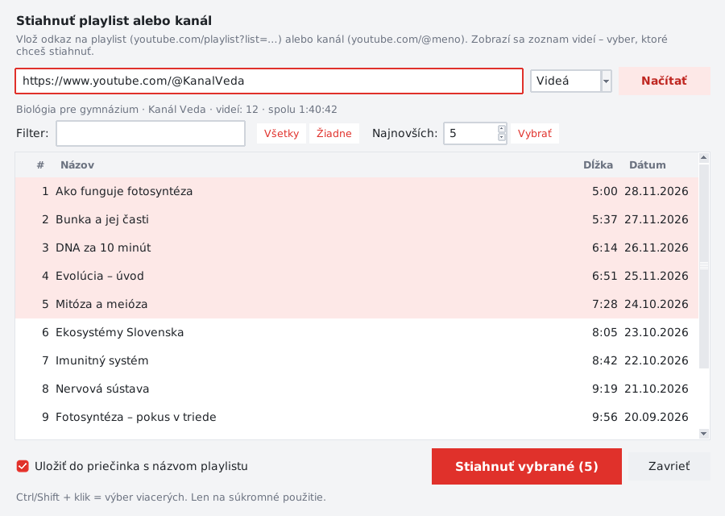
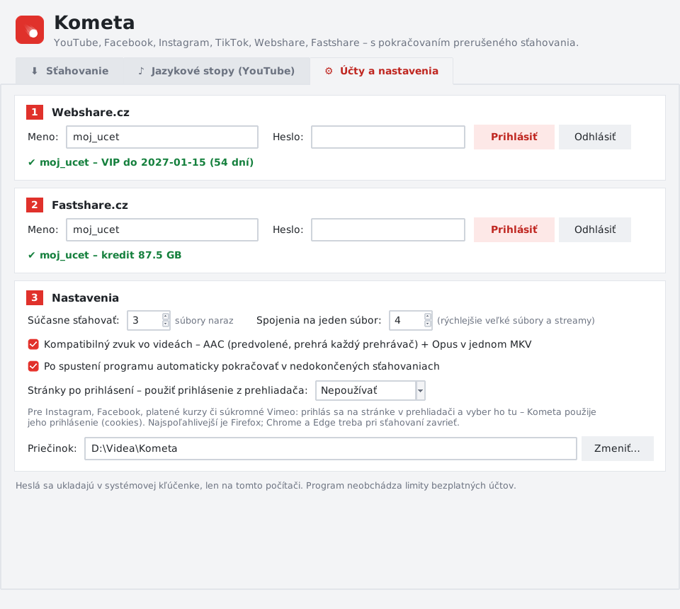

<p align="center"></p>

<h1 align="center">Kometa</h1>

<p align="center">Sťahovanie videí a súborov z akejkoľvek stránky – s pokračovaním prerušeného sťahovania<br>
YouTube · Vimeo (aj vložené) · Facebook · Instagram · TikTok (bez vodoznaku) · Webshare · Fastshare · kurzy a články</p>


## Čo Kometa vie

- **Sťahuje z YouTube, Facebooku, Instagramu, TikToku** a z ďalších viac ako 1000 stránok, ktoré podporuje [yt-dlp](https://github.com/yt-dlp/yt-dlp), aj z priamych odkazov na súbory.
- **Akákoľvek stránka – vlastný skener.** Nájde video aj tam, kde ho iné nástroje nevidia: vložené prehrávače (Vimeo aj s obmedzením na doménu, YouTube, Wistia, Bunny, JW Player, Brightcove, Cloudflare Stream, Dailymotion, Loom…), streamy HLS/DASH, `<video>`, adresy schované v JavaScripte, OpenGraph a JSON-LD, aj prehrávače vo vnorených rámčekoch. Každému nálezu priradí skóre (reklamy idú preč) a správny Referer stránky.
- **Viac spojení naraz.** Veľké súbory sa delia na úseky; voľné spojenie prevezme polovicu najväčšieho zvyšku a pri odmietnutí serverom (429/503) sa počet spojení sám zníži. Streamy HLS/DASH sa sťahujú po viacerých kúskoch súčasne.
- **Playlisty a kanály.** Celý playlist alebo kanál YouTube (Videá, Shorts, Naživo) so zoznamom na výber: všetky, najnovších N alebo podľa filtra názvu. Ukladá sa do priečinka s názvom playlistu.
- **TikTok bez vodoznaku.** Verzie s vodoznakom sa vynechávajú.
- **Webshare.cz a Fastshare.cz** cez tvoj vlastný účet (Webshare cez oficiálne API).
- **Pokračovanie prerušeného sťahovania.** Pri pauze, výpadku siete aj po zatvorení programu sa pokračuje od miesta, kde sa skončilo. Keď odkaz z úložiska vyprší, Kometa si vypýta nový.
- **Front sťahovania**: viac súborov naraz, pauza a pokračovanie, front ostane uložený aj po reštarte.
- **Jazykové stopy z YouTube**: z videí s preloženým zvukom stiahne vybrané jazyky a spojí ich s videom do jedného `.mkv`. Predvolené poradie je CZ, SK, EN, EN-US, PL, HU a pôvodná stopa ide na koniec.
- Formáty: najlepšia kvalita, MP4 pre TV a mobil, najviac 1080p alebo 720p, MP3, zvuk v pôvodnej kvalite.

| Playlist / kanál | Prehľadať stránku |
|---|---|
|  |  |

| Jazykové stopy | Účty a nastavenia |
|---|---|
|  |  |

## Inštalácia (Windows 10/11)

1. Stiahni Kometu: zelené tlačidlo **Code → Download ZIP** a rozbaľ ju (napr. do `Dokumenty\Kometa`).
2. Dvakrát klikni na **`Instalacia.bat`**. Cez `winget` nainštaluje Python, FFmpeg, Deno a knižnice (yt-dlp, requests, keyring) a na plochu dá ikonu **Kometa**.
   - Ak na konci napíše, že ho treba spustiť ešte raz (pri prvej inštalácii Pythonu), zavri okno a spusti ho znova.
   - Ak sa objaví „Windows ochránil váš počítač“, klikni na **Ďalšie informácie → Spustiť aj tak**.
3. Kometu spúšťaj ikonou na ploche alebo cez **`Spustit.bat`**. Pri každom spustení sa aktualizuje yt-dlp, pretože stránky sa často menia.

<details>
<summary>Ručná inštalácia / iný systém</summary>

Treba Python 3.10+, [FFmpeg](https://ffmpeg.org) a [Deno](https://deno.com) (YouTube ho dnes vyžaduje).

```
pip install -U -r requirements.txt
python app.py
```
</details>

## Používanie

### Karta Sťahovanie
1. Vlož jeden alebo viac odkazov (každý na nový riadok) alebo klikni na **Vložiť zo schránky**.
2. Vyber formát a priečinok a klikni na **Stiahnuť**. Odkaz môže byť aj na bežnú stránku (kurz, článok): ak ju yt-dlp nepozná, Kometa ju prehľadá skenerom – jedno video stiahne hneď, viac videí pridá do frontu.
   - **Playlist / kanál…** (alebo vlož odkaz na playlist či kanál a klikni na Stiahnuť) ukáže zoznam videí; vyber všetky, najnovších N alebo filtruj podľa názvu.
   - **Prehľadať stránku…** ukáže všetko, čo sa na stránke našlo (prehrávače, streamy, videá, súbory), a ty vyberieš, čo stiahnuť. Pri videu chránenom heslom (Vimeo) ho zadaj dole v okne.
3. Vo fronte vidíš priebeh, rýchlosť a zostávajúci čas.
   - **Dvojklik:** hotové otvorí priečinok so súborom, rozbehnuté pozastaví, pozastavené spustí, pri chybe ukáže podrobnosti.
   - **Pravé tlačidlo:** ďalšie možnosti (kopírovať odkaz, odstrániť…).

### Karta Jazykové stopy (YouTube)
Pre videá, ktoré majú na YouTube viac zvukových stôp (preklad či dabing). Vlož odkaz, klikni na **Načítať jazyky** a zaškrtni jazyky. Pod zoznamom vidíš výsledné poradie stôp. Vznikne jedno `.mkv` video; jazyk prepneš v prehrávači (VLC: *Zvuk → Zvuková stopa*). Stopy sa dajú pridať aj k videu, ktoré už máš stiahnuté.

**Kompatibilný zvuk** (prepínač, predvolene zapnutý): YouTube dáva preklady najmä vo formáte Opus, ktorý niektoré televízory, autorádiá a staršie prehrávače nevedia prehrať. So zapnutým prepínačom má každý jazyk dve stopy:
1. **AAC** – prehrá ho každý prehrávač; tieto stopy idú prvé v poradí CZ → SK → … a prvá je predvolená. Ak YouTube AAC pre daný jazyk neponúka, Kometa ho prevedie z Opus (FFmpeg, 192 kb/s).
2. **Opus** – tie isté jazyky v lepšej kvalite, s názvom „Opus (vyššia kvalita)“. Lepší prehrávač (VLC, mpv, Kodi) si ich vyberie v menu zvuku.

Keď prepínač vypneš, vo výsledku budú len stopy Opus (menší súbor). Rovnaký prepínač je aj v karte *Účty a nastavenia* a platí pre bežné sťahovanie videí z YouTube.

### Karta Účty a nastavenia
- **Webshare / Fastshare:** zadaj meno a heslo a klikni na **Prihlásiť**. Heslo sa uloží do *Správcu poverení Windows*, nikam inam sa neposiela. Na rýchle sťahovanie treba **VIP (Webshare)** alebo **kredit (Fastshare)**. Kometa neobchádza obmedzenia bezplatných účtov.
- **Stránky po prihlásení** (Instagram, Facebook, platené kurzy, súkromné Vimeo): prihlás sa v prehliadači a tu ho vyber – Kometa použije jeho prihlásenie (cookies) pri sťahovaní aj pri prehľadávaní stránok. Najspoľahlivejší je **Firefox**; Chrome a Edge treba pri sťahovaní zavrieť.
- **Súčasne sťahovať** (počet súborov naraz) a **Spojenia na jeden súbor** (1–16, predvolene 4).
- **Kompatibilný zvuk vo videách:** AAC (predvolená stopa) + Opus v jednom `.mkv`. Dá sa vypnúť.
- Automatické pokračovanie nedokončených sťahovaní po spustení.

## Ako funguje pokračovanie sťahovania

Rozpracovaný súbor sa ukladá ako `názov.part`. Pri ďalšom pokuse sa server požiada len o zvyšok (HTTP Range), takže sa nesťahuje od začiatku. Pri sťahovaní cez viac spojení sa stav jednotlivých úsekov ukladá do `názov.kometa`. Pri výpadku siete Kometa skúša znova (až 12-krát, s narastajúcim čakaním). Keď dočasný odkaz z Webshare alebo Fastshare vyprší, vypýta si nový a pokračuje. Front sa ukladá do `%USERPROFILE%\.kometa\fronta.json`, takže po zatvorení programu sa nedokončené súbory po ďalšom spustení samy dokončia.

## Príkazový riadok

```
py app.py ODKAZ [ODKAZ …] [-f video|mp4|1080|720|mp3|audio] [-o PRIEČINOK]
py app.py jazyky ODKAZ                         # video + CZ, SK, EN, EN-US, PL, HU → .mkv
py app.py jazyky ODKAZ --zoznam                # vypíše dostupné jazyky
py app.py jazyky ODKAZ -j cs sk en -o "D:\Videa"
py app.py jazyky ODKAZ --zvuk opus             # bez AAC stôp (oboje | aac | opus)
py app.py jazyky ODKAZ --k-videu "moje.mp4"    # pridá stopy k stiahnutému videu
```

## Keď niečo nejde

- **YouTube / TikTok zrazu nefunguje:** spusti Kometu znova cez `Spustit.bat` (aktualizuje yt-dlp).
- **„Obsah vyžaduje prihlásenie“:** v karte *Účty a nastavenia* vyber prehliadač, v ktorom si prihlásený.
- **Webshare / Fastshare hlási chybu účtu:** v karte *Účty a nastavenia* sa prihlás znova a skontroluj VIP alebo kredit.
- **„Chýba FFmpeg / Deno“:** spusti `Instalacia.bat`.

## Štruktúra projektu

```
app.py               spúšťač (okno aj príkazový riadok)
kometa/
  gui.py             okno s kartami
  fronta.py          front sťahovania, pauza/pokračovanie, uloženie
  httpdl.py          HTTP sťahovanie s pokračovaním (.part + Range) a cez viac spojení (úseky)
  skener.py          skener stránok: vložené prehrávače, streamy, JS/JSON, OpenGraph, JSON-LD, iframe
  hosts.py           Webshare (API) a Fastshare (prihlásenie, stránka súboru)
  media.py           YouTube/Facebook/Instagram/TikTok cez yt-dlp
  jazyky.py          jazykové stopy YouTube a spájanie cez FFmpeg
  common.py          nastavenia, heslá, pomôcky
```

## Vlastné jadro v Ruste (vo vývoji)

V priečinku [`jadro/`](jadro) vzniká nové jadro Komety v Ruste: jeden spustiteľný súbor bez inštalácie pre Windows, macOS, Linux a neskôr Android. Hotové je sťahovanie po úsekoch s pokračovaním, adaptívnym počtom spojení a obnovou odkazov. Pripravuje sa vlastné HLS a DASH so zastavením pri šifrovanom obsahu, potom Vimeo a skener stránok. Šifrovaný obsah (DRM) jadro zámerne nesťahuje.

```
cd jadro && cargo build --release
```

## Plán ďalšieho vývoja

1. **Titulky a prepis** – lokálny prepis reči (Whisper large-v3-turbo cez faster-whisper), titulky SRT/VTT vložené do MKV, preklad do slovenčiny.
2. **Sieťový skener + AI pomocník** – voliteľné zachytenie streamov cez Playwright pre stránky skladané JavaScriptom, AI pomocník pri zlyhaní, kapitoly a zhrnutia.
3. **Vlastný dabing a knižnica** – oddelenie hlasu od hudby (Demucs), slovenský dabing ako ďalšia zvuková stopa, vyhľadávanie vo videách podľa obsahu.

## Upozornenie

Kometa je určená na súkromné použitie. Sťahuj len obsah, na ktorý máš právo, a rešpektuj podmienky používania jednotlivých služieb.

## Licencia

[MIT](LICENSE). Kometa stojí na projektoch [yt-dlp](https://github.com/yt-dlp/yt-dlp) a [FFmpeg](https://ffmpeg.org).
