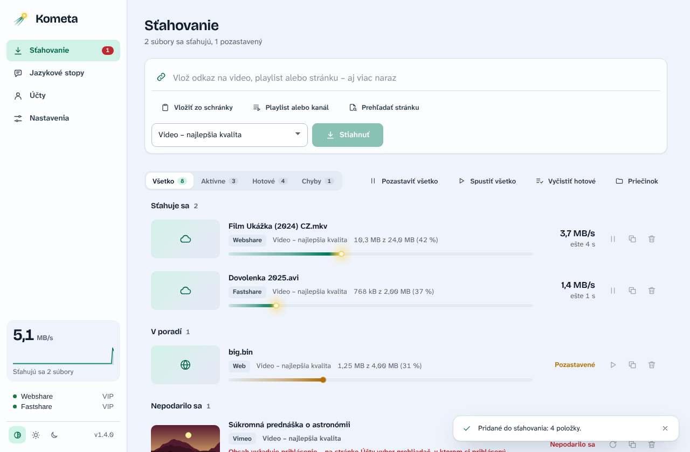
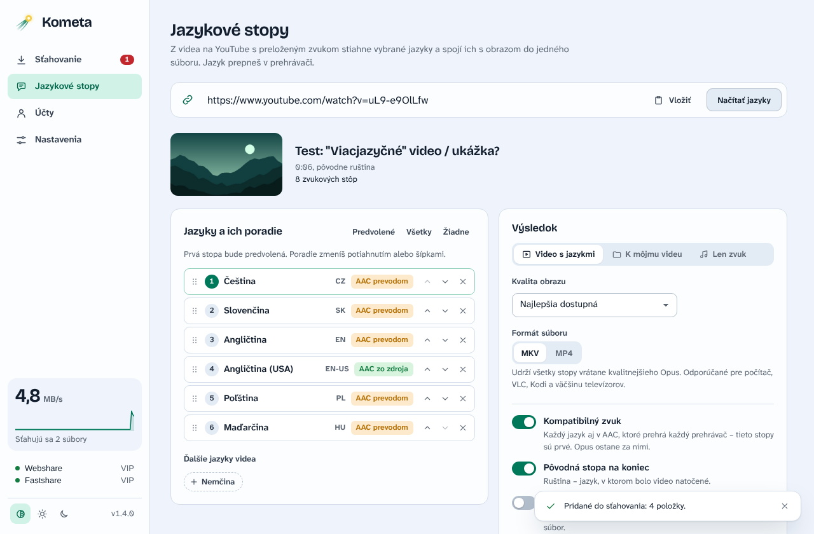
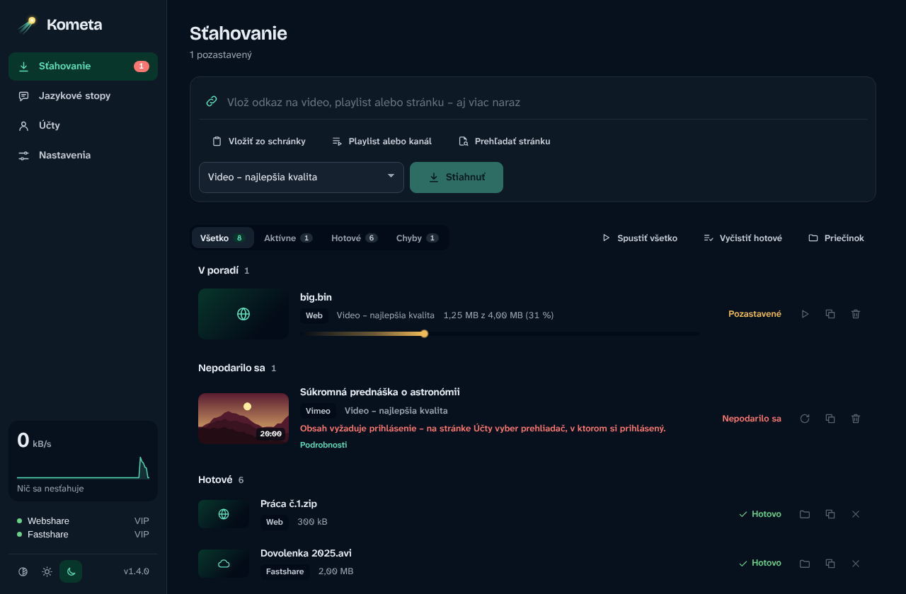
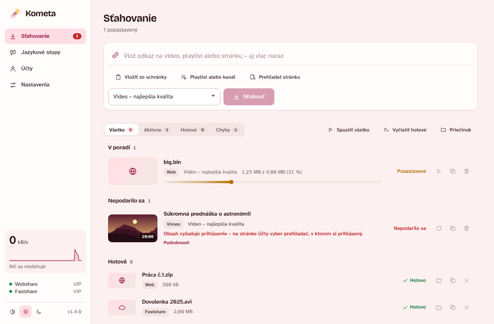

<p align="center"></p>

<h1 align="center">Kometa</h1>

<p align="center">Sťahovanie videí a súborov z akejkoľvek stránky – s pokračovaním prerušeného sťahovania<br>
YouTube · Vimeo (aj vložené) · Facebook · Instagram · TikTok (bez vodoznaku) · Webshare · Fastshare · Datoid · kurzy a články</p>



## Čo Kometa vie

- **Moderné rozhranie** so 7 farebnými témami, každou v dennom aj nočnom režime (alebo podľa systému). Priebeh sťahovania je kométa so svietiacim jadrom; front má náhľady videí. Odkazy stačí vložiť `Ctrl+V` alebo pretiahnuť z prehliadača. Viac v [docs/dizajn.md](docs/dizajn.md).
- **Sťahuje z YouTube, Facebooku, Instagramu, TikToku** a z ďalších viac ako 1000 stránok, ktoré podporuje [yt-dlp](https://github.com/yt-dlp/yt-dlp), aj z priamych odkazov na súbory.
- **Akákoľvek stránka – vlastný skener.** Nájde video aj tam, kde ho iné nástroje nevidia: vložené prehrávače (Vimeo aj s obmedzením na doménu, YouTube, Wistia, Bunny, JW Player, Brightcove, Cloudflare Stream, Dailymotion, Loom…), streamy HLS/DASH, `<video>`, adresy schované v JavaScripte, OpenGraph a JSON-LD, aj prehrávače vo vnorených rámčekoch. Každému nálezu priradí skóre (reklamy idú preč) a správny Referer stránky.
- **Viac spojení naraz.** Veľké súbory sa delia na úseky; voľné spojenie prevezme polovicu najväčšieho zvyšku a pri odmietnutí serverom (429/503) sa počet spojení sám zníži. Streamy HLS/DASH sa sťahujú po viacerých kúskoch súčasne.
- **Playlisty a kanály.** Celý playlist alebo kanál YouTube (Videá, Shorts, Naživo) so zoznamom na výber: všetky, najnovších N alebo podľa filtra názvu. Ukladá sa do priečinka s názvom playlistu.
- **TikTok bez vodoznaku.** Verzie s vodoznakom sa vynechávajú.
- **Webshare.cz, Fastshare.cz a Datoid.cz** cez tvoj vlastný účet (Webshare a Datoid cez ich rozhranie pre programy). Súbory chránené heslom: heslo zadáš pri odkaze alebo pri položke.
- **Archívy sa po stiahnutí samy rozbalia** – ZIP, 7z a RAR, aj zaheslované a rozdelené na časti (`.part1.rar`, `.7z.001`…). Rozdelený archív sa rozbalí, keď sú stiahnuté všetky časti.
- **Strážca schránky** (aplikácia): skopíruješ odkaz (`Ctrl+C`) a Kometa ho zachytí – len odloží, alebo hneď stiahne.
- **Kurzy po prihlásení** (aplikácia): vlastné okno prehliadača, v ktorom sa prihlásiš; Kometa načíta lekcie kurzu a stiahne ich do priečinkov podľa kapitol. Video chránené DRM nestiahne.
- **Pokračovanie prerušeného sťahovania.** Pri pauze, výpadku siete aj po zatvorení programu sa pokračuje od miesta, kde sa skončilo. Keď odkaz z úložiska vyprší, Kometa si vypýta nový.
- **Front sťahovania**: viac súborov naraz, pauza a pokračovanie, front ostane uložený aj po reštarte.
- **Jazykové stopy z YouTube**: z videí s preloženým zvukom stiahne vybrané jazyky a spojí ich s videom do jedného `.mkv` alebo `.mp4`. Predvolené poradie je CZ, SK, EN, PL, HU, RU (zmeníš ho ťahaním) a pôvodná stopa ide na koniec. Pri každom jazyku zvolíš AAC, Opus alebo oboje; stopy idú po jazykoch – CZ (AAC), CZ (Opus), SK (AAC)… Jazyky zvolíš aj pre celý playlist či kanál naraz.
- Formáty: najlepšia kvalita, MP4 pre TV a mobil, najviac 1080p alebo 720p, MP3, zvuk v pôvodnej kvalite.

| Jazykové stopy | Nastavenia a témy |
|---|---|
|  |  |

| Playlist / kanál | Prehľadať stránku |
|---|---|
|  |  |

| Nočný režim | Téma Súmrak |
|---|---|
|  |  |

## Inštalácia

Kometa je v dvoch vydaniach s tým istým rozhraním:

| | **Aplikácia** (nová, jadro v Ruste) | **Kometa pre Python** |
|---|---|---|
| inštalácia | jeden inštalátor, bez Pythonu | `Instalacia.bat` (Python, FFmpeg, knižnice) |
| systémy | Windows, macOS, Linux | Windows (inde ručne) |
| stránky, Vimeo, streamy, súbory | áno, vlastným jadrom | áno |
| Webshare, Fastshare, Datoid | áno | áno |
| rozbaľovanie archívov | ZIP, 7z, RAR – samo | ZIP samo, 7z a RAR cez 7-Zip |
| strážca schránky, kurzy po prihlásení | áno | nie |
| YouTube a ďalšie služby | áno, cez yt-dlp (doinštaluje sa jedným klikom) | áno |
| jazykové stopy YouTube | áno, aj bez FFmpeg | áno |

### Aplikácia

Z [Vydaní (Releases)](https://github.com/tarzanislav/kometa/releases) stiahni súbor pre svoj systém:

- **Windows 10/11:** `Kometa-X.Y.Z-windows-x64-setup.exe` – inštaluje sa len pre teba, bez práv správcu. Inštalátor nie je digitálne podpísaný, preto Windows ukáže „Windows ochránil váš počítač“ → **Ďalšie informácie → Spustiť aj tak**.
- **macOS 11+ (Apple Silicon aj Intel):** `Kometa-X.Y.Z-macos.dmg` – presuň Kometu do Aplikácií. Pri prvom spustení: pravé tlačidlo → **Otvoriť** (alebo Nastavenia systému → Súkromie a bezpečnosť → **Aj tak otvoriť**).
- **Linux:** `Kometa-X.Y.Z-linux-x86_64.AppImage` (stačí povoliť spustenie) alebo `Kometa-X.Y.Z-linux-amd64.deb` pre Ubuntu/Debian.
- **Bez inštalácie, pre príkazový riadok:** `kometa-X.Y.Z-…-noGUI` je jeden súbor bez vlastného okna (dvojklikom sa nič neotvorí). Príkaz `kometa okno` z neho otvorí rozhranie v okne Edge/Chrome, ostatné príkazy sú v časti o jadre nižšie. Na bežné používanie stačí aplikácia vyššie.

Kontrolné súčty všetkých súborov sú v `SHA256SUMS.txt`.

### Kometa pre Python (Windows 10/11)

1. Stiahni Kometu z [Vydaní (Releases)](https://github.com/tarzanislav/kometa/releases): súbor `Kometa-X.Y.Z.zip`. Rozbaľ ho (napr. do `Dokumenty\Kometa`). Pri aktualizácii stačí rozbaliť cez staré súbory – nastavenia, účty a front ostanú.
2. Dvakrát klikni na **`Instalacia.bat`**. Cez `winget` nainštaluje Python, FFmpeg, Deno a knižnice (yt-dlp, requests, keyring, pywebview) a na plochu dá ikonu **Kometa**.
   - Ak na konci napíše, že ho treba spustiť ešte raz (pri prvej inštalácii Pythonu), zavri okno a spusti ho znova.
   - Ak sa objaví „Windows ochránil váš počítač“, klikni na **Ďalšie informácie → Spustiť aj tak**.
3. Kometu spúšťaj ikonou na ploche alebo cez **`Spustit.bat`**. Pri každom spustení sa aktualizuje yt-dlp, pretože stránky sa často menia.

<details>
<summary>Ručná inštalácia / iný systém</summary>

Treba Python 3.10+, [FFmpeg](https://ffmpeg.org) a [Deno](https://deno.com) (YouTube ho dnes vyžaduje).

```
pip install -U -r requirements.txt
python app.py                # nové rozhranie v okne aplikácie
python app.py --prehliadac   # to isté v okne prehliadača Edge/Chrome (bez pywebview)
python app.py --klasicke     # pôvodné jednoduché okno
```

Okno aplikácie používa vo Windows WebView2 (súčasť Windows 10/11), v macOS WebKit a v Linuxe GTK alebo Qt. Ak okno nejde otvoriť, Kometa sa sama otvorí v okne prehliadača.
</details>

## Používanie

### Sťahovanie
1. Vlož jeden alebo viac odkazov (každý na nový riadok), klikni na **Vložiť zo schránky**, stlač `Ctrl+V` kdekoľvek v okne alebo odkaz pretiahni z prehliadača. Pod poľom vidíš, čo Kometa v odkazoch rozpoznala.
2. Vyber formát a klikni na **Stiahnuť** (alebo `Enter`). Formát platí len pre videostránky (YouTube, Vimeo…); súbory z Webshare a Fastshare sa stiahnu tak, ako sú na úložisku – s pôvodným názvom a príponou. Odkaz môže byť aj na bežnú stránku (kurz, článok): ak ju yt-dlp nepozná, Kometa ju prehľadá skenerom – jedno video stiahne hneď, viac videí pridá do frontu.
   - **Playlist alebo kanál** ukáže mriežku videí; vyber všetky, žiadne, najnovších N alebo hľadaj v názvoch. Pri YouTube zvoľ dole formát **Video s jazykovými stopami** a nad videami sa ukáže výber jazykov pre všetky vybrané videá naraz (viac nižšie).
   - **Prehľadať stránku** ukáže všetko, čo sa na stránke našlo (prehrávače, streamy, videá, súbory); odporúčané sú vybrané. Pri videu chránenom heslom (Vimeo) ho zadaj dole v okne.
3. Front je rozdelený na *Sťahuje sa*, *V poradí*, *Nepodarilo sa* a *Hotové*. Pri každej položke je pauza alebo pokračovanie, kopírovanie odkazu a odstránenie; pri hotovej otvorenie priečinka, pri chybe vysvetlenie a **Skúsiť znova**. Hotovú položku odstrániš len zo zoznamu, alebo aj so súborom.
4. Tlačidlo **⋯** vedľa *Priečinok*:
   - **Vyčistiť front** – odstráni všetky položky (aj rozpracované); stiahnuté súbory ostanú na disku.
   - **Vymazať stiahnuté súbory…** – po potvrdení presunie do **Koša** súbory, ktoré stiahla Kometa, a vyčistí front. Iné súbory v priečinku ostanú; z Koša sa dajú obnoviť.

### Jazykové stopy (YouTube)
Pre videá, ktoré majú na YouTube viac zvukových stôp (preklad či dabing). Vlož odkaz a klikni na **Načítať jazyky**. Predvolené jazyky sú vybrané v poradí CZ, SK, EN, PL, HU, RU; poradie zmeníš ťahaním alebo šípkami, ďalšie jazyky pridáš kliknutím (zaradia sa za ne). Prvá stopa bude predvolená. Vyber, čo vytvoriť – **video s jazykmi**, **jazyky k tvojmu stiahnutému videu** alebo **len zvuk** – a formát **MKV** alebo **MP4**.

- **MKV** udrží všetky stopy vrátane kvalitnejšieho Opus.
- **MP4** má obraz H.264 a zvuk AAC – prehrá ho takmer každé zariadenie. Stopy Opus sa doň nepridávajú; H.264 dáva YouTube najviac v rozlíšení 1080p.

**Zvuk – AAC, Opus alebo oboje.** YouTube dáva preklady najmä vo formáte Opus, ktorý niektoré televízory, autorádiá a staršie prehrávače nevedia prehrať. Preto si pri jazykoch vyberieš:

- **AAC + Opus** (predvolené) – každý jazyk dvakrát: AAC, ktorý prehrá každý prehrávač, a hneď za ním ten istý jazyk v kvalitnejšom Opus;
- **Len AAC** – bez stôp Opus. Ak YouTube jazyk v AAC ponúka, len sa prebalí („AAC zo zdroja“); ak má len Opus, prevedie sa do AAC („AAC prevodom“, 192 kb/s) a Opus sa vynechá;
- **Len Opus** – menší súbor v pôvodnej kvalite.

Voľba **Zvuk pre všetky jazyky** nastaví všetky jazyky naraz a **pri každom jazyku** ju môžeš zmeniť zvlášť (napr. čeština AAC + Opus, slovenčina len AAC). Stopy idú vo výsledku po jazykoch: **CZ (AAC) → CZ (Opus) → SK (AAC) → SK (Opus) → EN (AAC) → EN (Opus)…** a prvá je predvolená. Predvolené poradie jazykov je **CZ, SK, EN, PL, HU, RU**; ďalšie jazyky, ktoré pridáš, idú za nimi. Ak video nemá stopu „EN“, ale má viac variantov angličtiny, vyberie sa americká (EN-US), inak britská.

Prevod do AAC potrebuje FFmpeg (Kometa pre Python ho má vždy; aplikácia bez neho nechá Opus a povie to). Rovnaká voľba zvuku je v Nastaveniach a platí aj pre bežné sťahovanie videí z YouTube.

**Celý playlist alebo kanál s jazykmi.** V karte *Sťahovanie* klikni na **Playlist alebo kanál**, vyber videá a dole formát **Video s jazykovými stopami**. Nad videami sa ukáže rovnaký výber ako pri jednom videu – poradie jazykov, AAC/Opus pre všetky aj pre každý jazyk zvlášť, video alebo len zvuk, MKV alebo MP4, kvalita a pôvodná stopa na koniec. Jazyky sa nezisťujú vopred: každé video dostane tie z vybraných jazykov, ktoré naozaj má, v zvolenom poradí; ktoré chýbajú, uvidíš v zázname. Pre video bez žiadneho z vybraných jazykov zvolíš **Stiahnuť s pôvodným zvukom** alebo **Preskočiť**. Pri položke vo fronte vidno, aké jazyky sa sťahujú, a priebeh ukazuje aj krok (napr. „Sťahujem: Slovenčina (2/4)…“).

Formát **Video s jazykmi** je aj v bežnom zozname formátov – vtedy sa pre každý vložený odkaz z YouTube použijú jazyky a voľby z karty *Jazykové stopy*. Odkazy z iných stránok sa stiahnu ako obyčajné video.

### Heslá a archívy
- **Súbor chránený heslom** (Webshare, Datoid): heslo zadaj vopred tlačidlom **Heslo** pod poľom na odkazy, alebo neskôr – položka sa hneď na začiatku zastaví a pri nej je políčko na heslo.
- **Archív po stiahnutí:** ZIP, 7z a RAR sa samy rozbalia vedľa archívu. Jediný súbor alebo priečinok z archívu sa dá rovno vedľa neho, viac súborov do priečinka s menom archívu. Zaheslovaný archív si vypýta heslo pri položke (nič sa nesťahuje znova); heslo zadané vopred sa použije aj pre archív. Nič z archívu sa nezapíše mimo cieľového priečinka.
- **Rozdelené archívy** (`.part1.rar`, `.r00`, `.7z.001`, `.zip.001`): rozbaľuje sa, keď sú stiahnuté všetky časti; dovtedy položka čaká.
- V *Nastaveniach → Archívy* vypneš automatické rozbaľovanie (archív potom rozbalíš tlačidlom pri položke) a zvolíš, či archív po rozbalení ostane, alebo pôjde do Koša.

### Zo schránky (aplikácia)
Zapni **Sledovať schránku**. Keď potom skopíruješ odkaz na YouTube, Webshare, Fastshare, Datoid, Vimeo, TikTok a pod. alebo priamy odkaz na video či archív, objaví sa v karte *Zo schránky* (pri YouTube s názvom a náhľadom). Odtiaľ ho stiahneš alebo zahodíš. Pri voľbe **Hneď stiahnuť** ide odkaz rovno do sťahovania zvoleným formátom; playlisty a kanály vždy počkajú na výber videí. Text, ktorý bol v schránke pred zapnutím, sa nezachytí, a ten istý odkaz sa nezachytí dvakrát.

### Kurzy (aplikácia)
Pre kurzy, na ktoré si prihlásený:
1. V karte *Kurzy* zadaj adresu portálu a klikni na **Otvoriť prehliadač**. Otvorí sa okno Komety s bežným prehliadačom – prihlás sa a prejdi na stránku kurzu so zoznamom lekcií.
2. Klikni na **Načítať lekcie z tejto stránky**. Kometa ukáže lekcie zoskupené podľa kapitol tak, ako sú na stránke; lekcie kurzu sú predvybrané, odkazy z menu a päty nie.
3. Uprav názov priečinka alebo lekcií, vyber formát a klikni na **Stiahnuť**. Lekcie sa uložia ako `Kurz/01 Kapitola/01 Lekcia.mp4`.

Prihlásenie (cookies) sa vezme z okna prehliadača, drží sa len v pamäti a pošle sa iba stránke kurzu – nie vloženým prehrávačom iných služieb. Okno prehliadača nemá žiadny prístup k jadru Komety. Video chránené DRM Kometa nestiahne a pri lekcii to napíše.

### Účty
- **Webshare / Fastshare / Datoid:** zadaj meno (pri Datoide e-mail) a heslo a klikni na **Prihlásiť**. Heslo sa uloží do systémovej kľúčenky (vo Windows *Správca poverení*), nikam inam sa neposiela. Na rýchle sťahovanie treba **VIP (Webshare)** alebo **kredit (Fastshare, Datoid)**. Kometa neobchádza obmedzenia bezplatných účtov.
- **Stránky po prihlásení** (Instagram, Facebook, platené kurzy, súkromné Vimeo): prihlás sa v prehliadači a tu ho vyber – Kometa použije jeho prihlásenie (cookies) pri sťahovaní aj pri prehľadávaní stránok. Najspoľahlivejší je **Firefox**; Chrome a Edge treba pri sťahovaní zavrieť.

### Nastavenia
- **Vzhľad:** 7 tém (Kometa, Polárna žiara, Súmrak, Les, More, Levanduľa, Grafit) a režim podľa systému, deň alebo noc. Režim prepneš aj ikonami dole v bočnom paneli.
- **Súčasne sťahovať** (1–6 súborov naraz) a **Spojenia na jeden súbor** (1–16, predvolene 4).
- **Zvuk vo videách z YouTube** (AAC + Opus, len AAC, len Opus) a **pokračovanie nedokončených sťahovaní po spustení**.
- **Priečinok na sťahovanie.**
- **Pomocníci** (aplikácia): yt-dlp a FFmpeg sa dajú doinštalovať jedným klikom. FFmpeg sa stiahne zo zostavení [BtbN/FFmpeg-Builds](https://github.com/BtbN/FFmpeg-Builds) (Windows, Linux) a pred použitím sa overí kontrolný súčet; v macOS ho nainštaluješ cez Homebrew (`brew install ffmpeg`).

## Ako funguje pokračovanie sťahovania

Rozpracovaný súbor sa ukladá ako `názov.part`. Pri ďalšom pokuse sa server požiada len o zvyšok (HTTP Range), takže sa nesťahuje od začiatku. Pri sťahovaní cez viac spojení sa stav jednotlivých úsekov ukladá do `názov.kometa`. Pri výpadku siete Kometa skúša znova (až 12-krát, s narastajúcim čakaním). Keď dočasný odkaz z Webshare alebo Fastshare vyprší, vypýta si nový a pokračuje. Front sa ukladá do `%USERPROFILE%\.kometa\fronta.json`, takže po zatvorení programu sa nedokončené súbory po ďalšom spustení samy dokončia.

## Príkazový riadok

```
py app.py ODKAZ [ODKAZ …] [-f video|mp4|1080|720|mp3|audio] [-o PRIEČINOK]
py app.py jazyky ODKAZ                         # video + CZ, SK, EN, PL, HU, RU → .mkv
py app.py jazyky ODKAZ --zoznam                # vypíše dostupné jazyky
py app.py jazyky ODKAZ -j cs sk en -o "D:\Videa"
py app.py jazyky ODKAZ --zvuk opus             # bez AAC stôp (oboje | aac | opus)
py app.py jazyky ODKAZ --mp4                   # výsledok ako MP4 (H.264 + AAC)
py app.py jazyky ODKAZ --k-videu "moje.mp4"    # pridá stopy k stiahnutému videu
```

## Keď niečo nejde

- **YouTube / TikTok zrazu nefunguje:** spusti Kometu znova cez `Spustit.bat` (aktualizuje yt-dlp).
- **„Obsah vyžaduje prihlásenie“:** na stránke *Účty* vyber prehliadač, v ktorom si prihlásený.
- **Webshare / Fastshare hlási chybu účtu:** na stránke *Účty* sa prihlás znova a skontroluj VIP alebo kredit.
- **Okno sa neotvorí:** spusti `py app.py --prehliadac` (rozhranie v okne Edge/Chrome) alebo `py app.py --klasicke`.
- **„Chýba FFmpeg / Deno“:** spusti `Instalacia.bat`.

## Štruktúra projektu

```
app.py               spúšťač (okno aj príkazový riadok)
ui/                  zdrojový kód rozhrania (Svelte 5 + TypeScript, Vite)
kometa/
  webui/             preložené rozhranie (vzniká z ui/ príkazom npm run build)
  webapp.py          okno aplikácie a API pre rozhranie
  gui.py             pôvodné jednoduché okno (--klasicke)
  fronta.py          front sťahovania, pauza/pokračovanie, uloženie
  httpdl.py          HTTP sťahovanie s pokračovaním (.part + Range) a cez viac spojení (úseky)
  skener.py          skener stránok: vložené prehrávače, streamy, JS/JSON, OpenGraph, JSON-LD, iframe
  hosts.py           Webshare (API) a Fastshare (prihlásenie, stránka súboru)
  media.py           YouTube/Facebook/Instagram/TikTok cez yt-dlp
  jazyky.py          jazykové stopy YouTube a spájanie cez FFmpeg
  common.py          nastavenia, heslá, pomôcky
jadro/               jadro v Ruste: sťahovanie, skener, spájanie MKV/MP4, služba pre okno (src/sluzba)
aplikacia/           aplikácia Tauri – natívne okno s tým istým rozhraním nad jadrom v Ruste
```

### Vývoj rozhrania

```
cd ui
npm ci
npm run dev      # vývoj (rozhranie sa pripojí k bežiacej Komete: py app.py --bez-okna)
npm run check    # kontrola typov
npm run build    # preloží rozhranie do kometa/webui
```

Preložené rozhranie je súčasťou repozitára, aby Kometa fungovala bez Node.js. CI overuje, že zodpovedá zdrojovému kódu v `ui/`.

### Vydanie

Nová verzia = číslo v `kometa/__init__.py` a `ui/package.json` a poznámky `docs/releases/vX.Y.Z.md`. Po odoslaní do vetvy `main` GitHub vydanie sám otestuje a zabalí a **čaká na schválenie vlastníkom** (prostredie `release` so schvaľovaním → *Review deployments → Approve*). Bez nastaveného schvaľovania sa automaticky nezverejní nič – vtedy sa vydanie spustí ručne cez *Actions → Vydanie → Run workflow* (verziu netreba písať).

## Aplikácia s jadrom v Ruste (vo vývoji)


Rovnaké rozhranie, ale bez Pythonu: natívne okno (Tauri – WebView2 vo Windows, WebKit v macOS a Linuxe) nad vlastným jadrom v Ruste. Okno sa s jadrom rozpráva jediným príkazom `volaj(metóda, argumenty)` – sú to tie isté metódy a tvary dát ako v okne pre Python, takže rozhranie je pre obe verzie spoločné.

- **front sťahovania** – súbežné sťahovanie, pauza a pokračovanie (aj po zatvorení a novom spustení), upratanie rozpracovaných častí pri odstránení; stránka s viacerými videami sa rozbalí do frontu;
- **všetko z jadra** – stránky, Vimeo, JW Player, Wistia, Cloudflare, Bunny, HLS, DASH a súbory, spájanie MKV/MP4 bez FFmpeg;
- **Webshare a Fastshare** cez vlastný účet (heslá v Správcovi poverení, Kľúčenke alebo Secret Service);
- **YouTube a stovky ďalších služieb cez yt-dlp** – ak chýba, doinštaluje sa jedným klikom v Nastaveniach z oficiálnych vydaní a overí sa SHA-256. S FFmpeg sťahuje a spája samotný yt-dlp (AAC aj Opus); bez FFmpeg yt-dlp len zistí formáty a obraz MP4 so zvukom M4A stiahne a spojí jadro;
- **nastavenia sú spoločné** s Kometou pre Python (`~/.kometa/nastavenia.json`), front má vlastný súbor.

**Jazykové stopy z YouTube** robí aplikácia celé sama: yt-dlp len zistí, aké jazyky video má; obraz a zvuky stiahne jadro po úsekoch a spojí ich vlastným spájaním – aj zvuk Opus z WebM a aj do videa, ktoré už máš stiahnuté. FFmpeg treba len vtedy, keď YouTube jazyk ponúka iba v Opus a chceš ho mať aj v AAC.

```
cargo build --release -p kometa-aplikacia     # natívna aplikácia (Linux potrebuje WebKitGTK 4.1)
cargo run --release -- okno                    # to isté rozhranie v okne Edge/Chrome, bez inštalácie
```

`kometa okno` je jeden súbor: rozhranie je vložené v programe a beží nad malým serverom na 127.0.0.1, ktorý odpovedá len s tajným 128-bitovým kľúčom z adresy okna a len pre hlavičku Host 127.0.0.1/localhost.

## Vlastné jadro v Ruste (vo vývoji)

V priečinku [`jadro/`](jadro) vzniká nové jadro Komety v Ruste: jeden spustiteľný súbor bez inštalácie pre Windows, macOS, Linux a neskôr Android. Už vie:

- **súbory** po úsekoch cez viac spojení s pokračovaním, adaptívnym počtom spojení a obnovou odkazov;
- **HLS** (`.m3u8`) aj **DASH** (`.mpd` – šablóny s číslom aj časovou osou, zoznamy, BaseURL) – vlastné parsery, kúsky sa sťahujú súbežne a po prerušení sa pokračuje;
- **výber kvality** (`--max-vyska`) a **jazykov zvuku v poradí** (`-j cs,sk,en`);
- **vlastné spájanie do MKV aj MP4 – bez FFmpeg.** Číta MPEG-TS (H.264, AAC), MP4/fragmentované MP4 a Matroska/WebM (H.264, HEVC, AV1, VP9, AAC, Opus, MP3, AC-3, E-AC-3 – pri MKV dopočíta časy dekódovania snímok B), zapisuje Matroska aj MP4 s jazykmi, názvami, predvolenou stopou a bodmi na pretáčanie. Nič sa neprekóduje, výsledok sa po zápise skontroluje. Zvláda B-snímky, edit listy aj nespojitosti časov v HLS. Pamäť ~10 MB aj pri veľkých súboroch. FFmpeg sa použije len pre formát, ktorý vlastné spájanie zatiaľ nepozná (napr. HEVC v MPEG-TS) – a nikdy potichu;
- **skener stránok** – vlastný čítač HTML prejde stránku aj vnorené rámčeky (2 úrovne), nájde prehrávače, streamy a súbory v značkách, atribútoch `data-*`, metaúdajoch (Open Graph, JSON-LD) aj v skriptoch, vynechá reklamy a vyberie hlavné video. Či ide o stránku, stream alebo súbor, rozhodne obsah – nie len typ, ktorý pošle server;
- **Vimeo** – verejné, neverejné (s kľúčom `h=…`) aj obmedzené na doménu: skener sám pošle adresu stránky, kde je video vložené (Referer). Pri videu s heslom povie, čo robiť;
- **JW Player, Wistia, Cloudflare Stream a Bunny Stream** cez ich verejné rozhrania prehrávača;
- **šifrovaný obsah (DRM) zámerne nesťahuje** – skončí kódom 2; živé vysielanie kódom 4; služby, ktoré jadro ešte nepozná (napr. YouTube), kódom 5 – tie zatiaľ sťahuje okno Komety.

```
cargo build --release
kometa okno                                        # okno Komety (rozhranie v okne prehliadača)
kometa skenuj STRÁNKA                              # čo je na stránke (★ = odporúčané), --json pre program
kometa info ODKAZ -j cs,sk                         # čo sa stiahne: kvality, jazyky a stopy – nič nesťahuje
kometa stiahni ODKAZ -o PRIEČINOK -j cs,sk,en      # stránka, prehrávač, HLS/DASH → MKV (alebo --mp4), súbor
kometa stiahni ODKAZ_NA_VIMEO --referer STRÁNKA    # video obmedzené na doménu, keď nemáš adresu celej stránky
kometa stiahni ODKAZ --max-vyska 1080 --json       # udalosti ako JSON pre okno Komety
kometa spoj -o film.mkv video.ts "cs.ts#zvuk#cs#Čeština" "sk.ts#zvuk#sk#Slovenčina"   # vlastné súbory → MKV/MP4
```

Ďalej: titulky (aj z Vimea), zápis zvuku Opus do .opus bez FFmpeg a Android.

## Plán ďalšieho vývoja

1. **Jadro v Ruste a aplikácia** – hotové: súbory, HLS, DASH, vlastné spájanie do MKV/MP4 bez FFmpeg, skener stránok, Vimeo a ďalšie prehrávače, front, účty Webshare/Fastshare, yt-dlp ako pomocník a natívne okno (Tauri). Jazykové stopy YouTube a inštalačné balíky sú hotové. Ďalej titulky a Android.
2. **Titulky a preklad lokálnou AI** – prepis reči, preložené titulky vložené do MKV/MP4. Bez účtu, bez internetu, bez kreditov.
3. **AI dabing** – preklad zvuku do iného jazyka ako nová zvuková stopa: šablóny hlasov (ženské a mužské, rôzny vek), prirodzený prednes, zachovaná hudba a zvuky pozadia. Podrobný plán a pravidlá (licencie hlasov, ochrana skutočných ľudí, označovanie) sú v [docs/plan-ai.md](docs/plan-ai.md).

## Upozornenie

Kometa je určená na súkromné použitie. Sťahuj len obsah, na ktorý máš právo, a rešpektuj podmienky používania jednotlivých služieb.

## Licencia

[MIT](LICENSE). Kometa stojí na projektoch [yt-dlp](https://github.com/yt-dlp/yt-dlp) a [FFmpeg](https://ffmpeg.org); zoznam všetkých cudzích súčastí a ich licencií je v [docs/zdroje.md](docs/zdroje.md).
