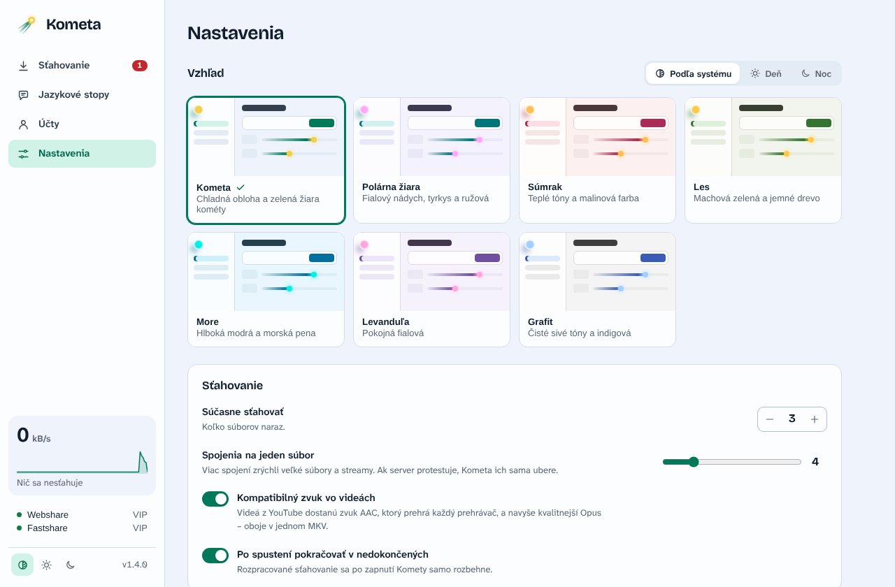
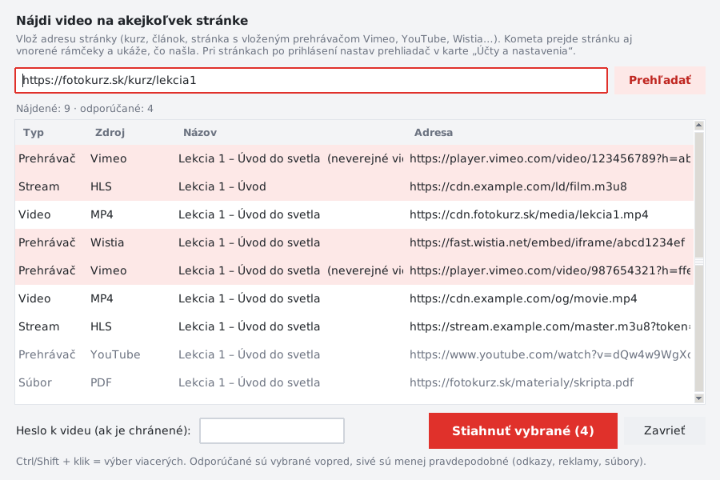
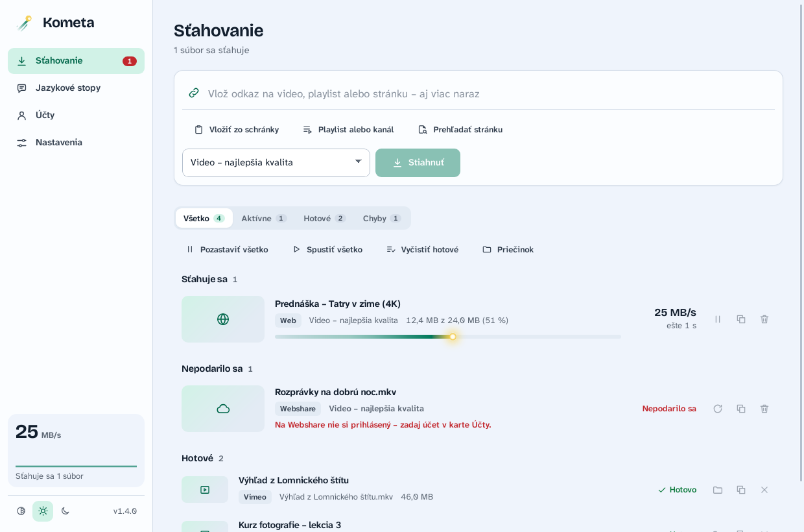

<p align="center"></p>

<h1 align="center">Kometa</h1>

<p align="center">Sťahovanie videí a súborov z akejkoľvek stránky – s pokračovaním prerušeného sťahovania<br>
YouTube · Vimeo (aj vložené) · Facebook · Instagram · TikTok (bez vodoznaku) · Webshare · Fastshare · Datoid · kurzy a články</p>


## Čo Kometa vie

- **Moderné rozhranie** so 7 farebnými témami, každou v dennom aj nočnom režime (alebo podľa systému). Priebeh sťahovania je kométa so svietiacim jadrom; front má náhľady videí. Odkazy stačí vložiť `Ctrl+V` alebo pretiahnuť z prehliadača. Viac v [docs/dizajn.md](docs/dizajn.md).
- **Sťahuje z YouTube, Facebooku, Instagramu, TikToku** a z ďalších viac ako 1000 stránok, ktoré podporuje [yt-dlp](https://github.com/yt-dlp/yt-dlp), aj z priamych odkazov na súbory.
- **Akákoľvek stránka – vlastný skener.** Nájde video aj tam, kde ho iné nástroje nevidia: vložené prehrávače (Vimeo aj s obmedzením na doménu, YouTube, Wistia, Bunny, JW Player, Brightcove, Cloudflare Stream, Dailymotion, Loom…), streamy HLS/DASH, `<video>`, adresy schované v JavaScripte, OpenGraph a JSON-LD, aj prehrávače vo vnorených rámčekoch. Každému nálezu priradí skóre (reklamy idú preč) a správny Referer stránky.
- **Viac spojení naraz.** Veľké súbory sa delia na úseky; voľné spojenie prevezme polovicu najväčšieho zvyšku a pri odmietnutí serverom (429/503) sa počet spojení sám zníži. Streamy HLS/DASH sa sťahujú po viacerých kúskoch súčasne.
- **Playlisty a kanály.** Celý playlist alebo kanál YouTube (Videá, Shorts, Naživo) so zoznamom na výber: všetky, najnovších N alebo podľa filtra názvu. Ukladá sa do priečinka s názvom playlistu.
- **TikTok bez vodoznaku.** Verzie s vodoznakom sa vynechávajú.
- **Webshare.cz, Fastshare.cz a Datoid.cz** cez tvoj vlastný účet (Webshare a Datoid cez ich rozhranie pre programy). Súbory chránené heslom: heslo zadáš pri odkaze alebo pri položke.
- **Archívy sa po stiahnutí samy rozbalia** – ZIP, 7z a RAR, aj zaheslované a rozdelené na časti (`.part1.rar`, `.7z.001`…). Rozdelený archív sa rozbalí, keď sú stiahnuté všetky časti.
- **Strážca schránky** (aplikácia): skopíruješ odkaz (`Ctrl+C`) a Kometa ho zachytí – len odloží, alebo hneď stiahne.
- **Kurzy po prihlásení** (aplikácia): vlastné okno prehliadača, v ktorom sa prihlásiš; Kometa načíta lekcie kurzu a stiahne ich do priečinkov podľa kapitol. Video chránené DRM nestiahne.
- **Pokračovanie prerušeného sťahovania.** Pri pauze, výpadku siete aj po zatvorení programu sa pokračuje od miesta, kde sa skončilo. Keď odkaz z úložiska vyprší, Kometa si vypýta nový.
- **Front sťahovania**: viac súborov naraz, pauza a pokračovanie, front ostane uložený aj po reštarte.
- **Jazykové stopy z YouTube**: z videí s preloženým zvukom stiahne vybrané jazyky a spojí ich s videom do jedného `.mkv` alebo `.mp4`. Predvolené poradie je CZ, SK, EN, PL, HU, RU (zmeníš ho ťahaním) a pôvodná stopa ide na koniec. Pri každom jazyku zvolíš AAC, Opus alebo oboje; stopy idú po jazykoch – CZ (AAC), CZ (Opus), SK (AAC)… Jazyky zvolíš aj pre celý playlist či kanál naraz.
- **Titulky, kapitoly, údaje o videu a obrázok priamo v súbore** – v MKV aj v MP4, vlastným kódom bez FFmpeg. Titulky ku každému jazyku zvuku, kapitoly z YouTube, názov, autor, dátum, odkaz a popis videa, náhľad ako obrázok súboru; dabing a pôvodný jazyk sú označené (prehrávače a Jellyfin to ukážu).
- **Automatická aktualizácia:** nová verzia sa stiahne z GitHubu, overí kontrolným súčtom a nainštaluje, keď potvrdíš – inak sama pri ďalšom spustení.
- Formáty: najlepšia kvalita, MP4 pre TV a mobil, najviac 1080p alebo 720p, MP3, zvuk v pôvodnej kvalite.

| Jazykové stopy | Nastavenia a témy |
|---|---|
|  |  |

| Playlist / kanál | Prehľadať stránku |
|---|---|
|  |  |

| Nočný režim | Téma Súmrak |
|---|---|
|  |  |

## Inštalácia

Z [Vydaní (Releases)](https://github.com/tarzanislav/kometa/releases) stiahni súbor pre svoj systém:

- **Windows 10/11:** `Kometa-X.Y.Z-windows-x64-setup.exe` – inštaluje sa len pre teba, bez práv správcu. Inštalátor nie je digitálne podpísaný, preto Windows ukáže „Windows ochránil váš počítač“ → **Ďalšie informácie → Spustiť aj tak**.
- **macOS 11+ (Apple Silicon aj Intel):** `Kometa-X.Y.Z-macos.dmg` – presuň Kometu do Aplikácií. Pri prvom spustení: pravé tlačidlo → **Otvoriť** (alebo Nastavenia systému → Súkromie a bezpečnosť → **Aj tak otvoriť**).
- **Linux:** `Kometa-X.Y.Z-linux-x86_64.AppImage` (stačí povoliť spustenie) alebo `Kometa-X.Y.Z-linux-amd64.deb` pre Ubuntu/Debian.
- **Bez inštalácie, pre príkazový riadok:** `kometa-X.Y.Z-…-noGUI` je jeden súbor bez vlastného okna (dvojklikom sa nič neotvorí). Príkaz `kometa okno` z neho otvorí rozhranie v okne Edge/Chrome, ostatné príkazy sú v časti o jadre nižšie. Na bežné používanie stačí aplikácia vyššie.

Kontrolné súčty všetkých súborov sú v `SHA256SUMS.txt`.

### Prechod z Kometa pre Python

Kometa 2.0 je už len aplikácia – Kometa pre Python sa ďalej nevydáva. Ak ju ešte máš, nainštaluj aplikáciu (vo verzii 1.12 to urobí tlačidlo **Prejsť na aplikáciu**). Aplikácia prevezme nastavenia a účty a pri prvom spustení aj nedokončené sťahovania z frontu. Python, FFmpeg ani Deno, ktoré inštaloval `Instalacia.bat`, aplikácia nepotrebuje: pomocníkov si stiahne sama. Priečinok so starou Kometou potom môžeš zmazať.

## Používanie

### Sťahovanie
1. Vlož jeden alebo viac odkazov (každý na nový riadok), klikni na **Vložiť zo schránky**, stlač `Ctrl+V` kdekoľvek v okne alebo odkaz pretiahni z prehliadača. Pod poľom vidíš, čo Kometa v odkazoch rozpoznala.
2. Vyber formát a klikni na **Stiahnuť** (alebo `Enter`). Formát platí len pre videostránky (YouTube, Vimeo…); súbory z Webshare a Fastshare sa stiahnu tak, ako sú na úložisku – s pôvodným názvom a príponou. Odkaz môže byť aj na bežnú stránku (kurz, článok): ak ju yt-dlp nepozná, Kometa ju prehľadá skenerom – jedno video stiahne hneď, viac videí pridá do frontu.
   - **Playlist alebo kanál** ukáže mriežku videí; vyber všetky, žiadne, najnovších N alebo hľadaj v názvoch. Pri YouTube zapni nad videami **S jazykovými stopami** – ukáže sa výber jazykov pre všetky vybrané videá naraz (viac nižšie).
   - **Prehľadať stránku** ukáže všetko, čo sa na stránke našlo (prehrávače, streamy, videá, súbory); odporúčané sú vybrané. Pri videu chránenom heslom (Vimeo) ho zadaj dole v okne.
3. Front je rozdelený na *Sťahuje sa*, *V poradí*, *Nepodarilo sa* a *Hotové*. Pri každej položke je pauza alebo pokračovanie, kopírovanie odkazu a odstránenie; pri hotovej otvorenie priečinka, pri chybe vysvetlenie a **Skúsiť znova**. Hotovú položku odstrániš len zo zoznamu, alebo aj so súborom.
4. Tlačidlo **⋯** vedľa *Priečinok*:
   - **Vyčistiť front** – odstráni všetky položky (aj rozpracované); stiahnuté súbory ostanú na disku.
   - **Vymazať stiahnuté súbory…** – po potvrdení presunie do **Koša** súbory, ktoré stiahla Kometa, a vyčistí front. Iné súbory v priečinku ostanú; z Koša sa dajú obnoviť.

### Jazykové stopy (YouTube)
Pre videá, ktoré majú na YouTube viac zvukových stôp (preklad či dabing). Vlož odkaz a klikni na **Načítať jazyky**. Predvolené jazyky sú vybrané v poradí CZ, SK, EN, PL, HU, RU; poradie zmeníš ťahaním alebo šípkami, ďalšie jazyky pridáš kliknutím (zaradia sa za ne). Prvá stopa bude predvolená. Vyber, čo vytvoriť – **video s jazykmi**, **jazyky k tvojmu stiahnutému videu** alebo **len zvuk** – a formát **MKV** alebo **MP4**.

- **MKV** udrží všetky stopy vrátane kvalitnejšieho Opus.
- **MP4** má obraz H.264 a zvuk AAC – prehrá ho takmer každé zariadenie. Stopy Opus sa doň nepridávajú; H.264 dáva YouTube najviac v rozlíšení 1080p.

**Zvuk – AAC, Opus alebo oboje.** YouTube dáva preklady najmä vo formáte Opus, ktorý niektoré televízory, autorádiá a staršie prehrávače nevedia prehrať. Preto si pri jazykoch vyberieš:

- **AAC + Opus** (predvolené) – každý jazyk dvakrát: AAC, ktorý prehrá každý prehrávač, a hneď za ním ten istý jazyk v kvalitnejšom Opus;
- **Len AAC** – bez stôp Opus. Ak YouTube jazyk v AAC ponúka, len sa prebalí („AAC zo zdroja“); ak má len Opus, prevedie sa do AAC („AAC prevodom“, 192 kb/s) a Opus sa vynechá;
- **Len Opus** – menší súbor v pôvodnej kvalite.

Voľba **Zvuk pre všetky jazyky** nastaví všetky jazyky naraz a **pri každom jazyku** ju môžeš zmeniť zvlášť (napr. čeština AAC + Opus, slovenčina len AAC). Stopy idú vo výsledku po jazykoch: **CZ (AAC) → CZ (Opus) → SK (AAC) → SK (Opus) → EN (AAC) → EN (Opus)…** a prvá je predvolená. Predvolené poradie jazykov je **CZ, SK, EN, PL, HU, RU**; ďalšie jazyky, ktoré pridáš, idú za nimi. Ak video nemá stopu „EN“, ale má viac variantov angličtiny, vyberie sa americká (EN-US), inak britská.

Prevod do AAC potrebuje FFmpeg (doinštaluješ ho jedným klikom v *Nastaveniach → Pomocníci*; bez neho Kometa nechá Opus a povie to). Rovnaká voľba zvuku je v Nastaveniach a platí aj pre bežné sťahovanie videí z YouTube.

**Viac videí naraz, celý kanál alebo playlist.** Do karty *Jazykové stopy* vlož namiesto jedného videa viac odkazov (každý na nový riadok) alebo odkaz na kanál či playlist:
- **Viac odkazov:** Kometa zistí, aké jazyky má každé video, a ukáže ich pri videu aj v súčte („CZ 3/3, SK 2/3…“). Nastavíš jazyky raz pre všetky a stiahneš vybrané videá, voliteľne do vlastného priečinka.
- **Kanál alebo playlist:** otvorí sa výber videí (všetky, žiadne, najnovších N, hľadanie) so zapnutými jazykovými stopami a s voľbami z karty. Rovnako to funguje v karte *Sťahovanie* → **Playlist alebo kanál** → prepínač **S jazykovými stopami**.

Výber jazykov je rovnaký ako pri jednom videu – poradie jazykov, AAC/Opus pre všetky aj pre každý jazyk zvlášť, video alebo len zvuk, MKV alebo MP4, kvalita a pôvodná stopa na koniec. Pri kanáli Kometa zistí jazyky zo vzorky 10 videí z celého výberu: pri každom jazyku vidno, v koľkých videách je („8/10“ alebo „nie je“), a jazyky, ktoré videá majú navyše, pridáš jedným klikom. Každé video potom dostane tie z vybraných jazykov, ktoré naozaj má, v zvolenom poradí; ktoré chýbajú, uvidíš v zázname. Pre video bez žiadneho z vybraných jazykov zvolíš **Stiahnuť s pôvodným zvukom** alebo **Preskočiť**. Pri položke vo fronte vidno, aké jazyky sa sťahujú, a priebeh ukazuje aj krok (napr. „Sťahujem: Slovenčina (2/4)…“).

**Titulky k jazykom.** Pri jednom videu aj pri viacerých zvolíš **Bez titulkov** alebo **K jazykom zvuku** – ku každému vybranému jazyku zvuku sa stiahnu aj titulky v tom istom jazyku (CZ zvuk → CZ titulky…). Najprv sa použijú titulky od autora videa; prepínač **Aj automatické titulky** doplní chýbajúce automatickými titulkami YouTube (strojovo rozpoznané alebo preložené, v názve stopy „(automatické)“). Titulky sa vložia do súboru ako samostatné stopy (predvolene vypnuté, zapneš ich v prehrávači) – do MKV ako SRT, do MP4 ako titulky MP4 (3GPP Timed Text), ktoré prehrajú aj telefóny, televízory a zariadenia Apple. Pri voľbe **Každý jazyk aj samostatne** sa uložia aj vedľa videa ako `video.cs.srt`. Pri jednom videu karta vopred ukáže, ku ktorým jazykom má video titulky od autora. Ktoré titulky chýbajú, uvidíš v zázname.

Formát **Video s jazykmi** je aj v bežnom zozname formátov – vtedy sa pre každý vložený odkaz z YouTube použijú jazyky a voľby z karty *Jazykové stopy*. Odkazy z iných stránok sa stiahnu ako obyčajné video.

### Údaje o videu, kapitoly a obrázok

Do stiahnutého videa (MKV aj MP4) Kometa vloží:
- **údaje o videu** – názov, autora (kanál), dátum zverejnenia, odkaz na video a popis; ukážu ich prehrávače, Windows vo vlastnostiach súboru aj knižnice médií (Plex, Jellyfin, Kodi);
- **kapitoly** – ak ich video má (YouTube: od autora, z popisu aj automatické); v prehrávači preskočíš na kapitolu. V MP4 sú v oboch bežných podobách (zoznam kapitol aj kapitolová stopa pre zariadenia Apple);
- **obrázok videa** – náhľad ako obrázok súboru (v MKV príloha `cover.jpg`, v MP4 obal);
- **roly stôp** – preložený zvuk je označený ako dabing, pôvodný jazyk ako originál.

Každú z týchto vecí vypneš v *Nastaveniach* (časť *Do stiahnutého videa vložiť*). Aplikácia to zapisuje vlastným kódom pri spájaní stôp (aj do `.opus`); pri MP3, ktoré sťahuje a prevádza yt-dlp s FFmpeg, použije jeho voľby na vloženie údajov, kapitol a obrázka. Priamy súbor z bežnej stránky ostane presne taký, aký je na webe.

### Automatická aktualizácia

Kometa sa po spustení a potom raz za 12 hodín pozrie na [vydania na GitHube](https://github.com/tarzanislav/kometa/releases). Novú verziu stiahne a overí súčtom SHA-256 zo zoznamu `SHA256SUMS.txt` (aj odtlačkom, ktorý o súbore uvádza GitHub) – neoverený súbor nikdy nespustí. V okne sa objaví pás **Nová verzia … je stiahnutá a overená** s tlačidlom **Nainštalovať teraz**; ak ju nenainštaluješ, nainštaluje sa sama pri ďalšom spustení (len raz – keď sa inštalácia nedokončí, neskúša sa dookola a okno to povie).

- **Windows:** inštalátor beží viditeľne s ukazovateľom priebehu, bez otázok, a potom sa Kometa spustí znova.
- **Linux:** AppImage sa vymení na mieste; balík DEB si vypýta heslo správcu.
- **macOS:** aplikácia sa vymení z obrazu DMG.
- **Program bez okna (noGUI)** sa vymení, nová verzia platí od ďalšieho spustenia.

Automatickú aktualizáciu vypneš v *Nastaveniach → Aktualizácie*; tam je aj **Skontrolovať teraz**.

### Heslá a archívy
- **Súbor chránený heslom** (Webshare, Datoid): heslo zadaj vopred tlačidlom **Heslo** pod poľom na odkazy, alebo neskôr – položka sa hneď na začiatku zastaví a pri nej je políčko na heslo.
- **Archív po stiahnutí:** ZIP, 7z a RAR sa samy rozbalia vedľa archívu. Jediný súbor alebo priečinok z archívu sa dá rovno vedľa neho, viac súborov do priečinka s menom archívu. Zaheslovaný archív si vypýta heslo pri položke (nič sa nesťahuje znova); heslo zadané vopred sa použije aj pre archív. Nič z archívu sa nezapíše mimo cieľového priečinka.
- **Rozdelené archívy** (`.part1.rar`, `.r00`, `.7z.001`, `.zip.001`): rozbaľuje sa, keď sú stiahnuté všetky časti; dovtedy položka čaká.
- **Heslá vopred pre veľa súborov naraz:** vo fronte aj v karte *Zo schránky* označ položky (zaškrtávacie políčka, aj „všetko v časti“) a zadaj **jedno heslo pre všetky označené**. Pri jednej položke stačí ikona zámku. Položky s heslom majú štítok *S heslom* – stiahnu sa a rozbalia bez pýtania.
- **Zabudnuté heslo:** keď archív zadané heslo neprijme alebo heslo chýba, Kometa najprv skúsi heslá, ktoré si zadal pri iných súboroch vo fronte (často má celá skupina jedno heslo). Až keď nesedí žiadne, opýta sa pri položke.
- V *Nastaveniach → Archívy* vypneš automatické rozbaľovanie (archív potom rozbalíš tlačidlom pri položke) a zvolíš, či archív po rozbalení ostane, alebo pôjde do Koša.

### Zo schránky (aplikácia)
Zapni **Sledovať schránku**. Keď potom skopíruješ odkaz na YouTube, Webshare, Fastshare, Datoid, Vimeo, TikTok a pod. alebo priamy odkaz na video či archív, objaví sa v karte *Zo schránky* (pri YouTube s názvom a náhľadom). Odtiaľ ho stiahneš alebo zahodíš. Pri voľbe **Hneď stiahnuť** ide odkaz rovno do sťahovania zvoleným formátom; playlisty a kanály vždy počkajú na výber videí. Text, ktorý bol v schránke pred zapnutím, sa nezachytí, a ten istý odkaz sa nezachytí dvakrát.

Kometa sa po zachytení sama prepne na kartu *Zo schránky* priamo k novým odkazom a na chvíľu ich zvýrazní – nie však, keď práve píšeš v Komete (prepínač **Ukázať zachytené odkazy**).

Odkazy skopírované naraz (napr. všetky diely z fóra) sú pod spoločným nadpisom *Skopírované naraz* – celú skupinu označíš jedným kliknutím a priradíš jej heslo. Keď je heslo priamo v skopírovanom texte (riadok „Heslo: …“, „Password: …“), Kometa ho priradí odkazom z tej istej kópie sama (štítok *Heslo zo schránky*).

### Kurzy (aplikácia)
Pre kurzy, na ktoré si prihlásený:
1. V karte *Kurzy* zadaj adresu portálu a klikni na **Otvoriť prehliadač**. Otvorí sa okno Komety s bežným prehliadačom – prihlás sa a prejdi na stránku kurzu so zoznamom lekcií.
2. Klikni na **Načítať lekcie z tejto stránky**. Kometa ukáže lekcie zoskupené podľa kapitol tak, ako sú na stránke; lekcie kurzu sú predvybrané, odkazy z menu a päty nie.
3. Uprav názov priečinka alebo lekcií, vyber formát a klikni na **Stiahnuť**. Lekcie sa uložia ako `Kurz/01 Kapitola/01 Lekcia.mp4`.

Prihlásenie (cookies) sa vezme z okna prehliadača, drží sa len v pamäti a pošle sa iba stránke kurzu – nie vloženým prehrávačom iných služieb. Okno prehliadača nemá žiadny prístup k jadru Komety. Video chránené DRM Kometa nestiahne a pri lekcii to napíše.

### Účty
- **Webshare / Fastshare / Datoid:** zadaj meno (pri Datoide e-mail) a heslo a klikni na **Prihlásiť**. Heslo sa uloží do systémovej kľúčenky (vo Windows *Správca poverení*), nikam inam sa neposiela. Na rýchle sťahovanie treba **VIP (Webshare)** alebo **kredit (Fastshare, Datoid)**. Kometa neobchádza obmedzenia bezplatných účtov.
- **Stránky po prihlásení** (Instagram, Facebook, platené kurzy, súkromné Vimeo): prihlás sa v prehliadači a tu ho vyber – Kometa použije jeho prihlásenie (cookies) pri sťahovaní aj pri prehľadávaní stránok. Cookies sa použijú len vtedy, keď stránka prihlásenie naozaj žiada (najprv sa skúsi bez nich). Najspoľahlivejší je **Firefox**; Chrome a Edge treba pri sťahovaní zavrieť.

### Nastavenia
- **Vzhľad:** 7 tém (Kometa, Polárna žiara, Súmrak, Les, More, Levanduľa, Grafit) a režim podľa systému, deň alebo noc. Režim prepneš aj ikonami dole v bočnom paneli.
- **Súčasne sťahovať** (1–6 súborov naraz) a **Spojenia na jeden súbor** (1–16, predvolene 4).
- **Zvuk vo videách z YouTube** (AAC + Opus, len AAC, len Opus) a **pokračovanie nedokončených sťahovaní po spustení**.
- **Do stiahnutého videa vložiť:** údaje o videu, kapitoly, obrázok videa (každé sa dá vypnúť).
- **Aktualizácie:** automaticky (predvolene zapnuté) a **Skontrolovať teraz**.
- **Priečinok na sťahovanie.**
- **Pomocníci:** **yt-dlp** a **Deno** (JavaScript, ktorý yt-dlp potrebuje na YouTube) si Kometa doinštaluje sama chvíľu po prvom spustení a raz denne skontroluje, či nie je nový yt-dlp (Deno pri novej hlavnej verzii) – z oficiálnych vydaní, overené kontrolným súčtom. Nepoužíva tie zo systému, takže nič netreba inštalovať zvlášť. FFmpeg (len MP3) sa dá doinštalovať jedným klikom. FFmpeg sa stiahne zo zostavení [BtbN/FFmpeg-Builds](https://github.com/BtbN/FFmpeg-Builds) (Windows, Linux) a pred použitím sa overí kontrolný súčet; v macOS ho nainštaluješ cez Homebrew (`brew install ffmpeg`).

## Ako funguje pokračovanie sťahovania

Rozpracovaný súbor sa ukladá ako `názov.part`. Pri ďalšom pokuse sa server požiada len o zvyšok (HTTP Range), takže sa nesťahuje od začiatku. Pri sťahovaní cez viac spojení sa stav jednotlivých úsekov ukladá do `názov.kometa`. Pri výpadku siete Kometa skúša znova (až 12-krát, s narastajúcim čakaním). Keď dočasný odkaz z Webshare alebo Fastshare vyprší, vypýta si nový a pokračuje. Front sa ukladá do `~/.kometa/fronta-jadro.json` (vo Windows `%USERPROFILE%\.kometa`), takže po zatvorení programu sa nedokončené súbory po ďalšom spustení samy dokončia.

## Príkazový riadok

Program `kometa` (súbor `kometa-X.Y.Z-…-noGUI` z vydaní, alebo `cargo build --release`) je celé jadro v jednom súbore bez inštalácie:

```
kometa okno                                        # okno Komety (rozhranie v okne prehliadača)
kometa skenuj STRÁNKA                              # čo je na stránke (★ = odporúčané), --json pre program
kometa info ODKAZ -j cs,sk                         # čo sa stiahne: kvality, jazyky a stopy – nič nesťahuje
kometa stiahni ODKAZ -o PRIEČINOK -j cs,sk,en      # stránka, prehrávač, HLS/DASH → MKV (alebo --mp4), súbor
kometa stiahni ODKAZ_NA_VIMEO --referer STRÁNKA    # video obmedzené na doménu, keď nemáš adresu celej stránky
kometa stiahni ODKAZ --max-vyska 1080 --json       # udalosti ako JSON pre okno Komety
kometa spoj -o film.mkv video.ts "cs.ts#zvuk#cs#Čeština" "sk.ts#zvuk#sk#Slovenčina"   # vlastné súbory → MKV/MP4
kometa spoj -o film.mp4 video.mp4 "sk.m4a#zvuk#sk#Slovenčina#dabing" "en.webm#zvuk#en#English#povodny" \
   "sk.srt#titulky#sk#Slovenčina" --kapitola "0=Úvod" --kapitola "95=Druhá časť" --obal nahlad.jpg \
   -t "Názov" --autor "Kanál" --datum 2024-05-17 --zdroj https://…   # titulky, kapitoly, údaje a obrázok
```

YouTube a služby cez yt-dlp, jazykové stopy a účty sú v okne (`kometa okno`).

## Keď niečo nejde

- **YouTube / TikTok zrazu nefunguje:** zatvor Kometu a spusti ju znova – do pol minúty si sama skontroluje a stiahne nový yt-dlp (inak to robí raz denne).
- **„Obsah vyžaduje prihlásenie“:** na stránke *Účty* vyber prehliadač, v ktorom si prihlásený.
- **Webshare / Fastshare hlási chybu účtu:** na stránke *Účty* sa prihlás znova a skontroluj VIP alebo kredit.
- **Okno sa neotvorí:** spusti program noGUI príkazom `kometa okno` – rozhranie sa otvorí v okne Edge/Chrome.
- **„Chýba yt-dlp / Deno / FFmpeg“:** *Nastavenia → Pomocníci → Doinštalovať*.
- **Antivírus hlási Kometu ako trójskeho koňa** (napr. Kaspersky `PDM:Trojan.Win32.Generic`): ide o odhad podľa správania – Kometa sťahuje súbory a spúšťa pomocníkov (yt-dlp, FFmpeg), ktorých si sama stiahla, a jej súbory zatiaľ nie sú digitálne podpísané. Over inštalačku: jej súčet SHA-256 porovnaj so `SHA256SUMS.txt` vo vydaní a skontroluj ju na [virustotal.com](https://www.virustotal.com). Falošný poplach nahlás výrobcovi antivírusu a Kometu pridaj medzi dôveryhodné aplikácie. Kometa sa správa čo najopatrnejšie: cookies prehliadača číta, len keď stránka žiada prihlásenie, archívy rozbaľuje vlastným kódom a schránku číta len po zmene.

## Štruktúra projektu

```
jadro/               jadro v Ruste: sťahovanie, skener, spájanie MKV/MP4/Ogg, služba pre okno (src/sluzba)
  webui/             preložené rozhranie (vzniká z ui/ príkazom npm run build, vkladá sa do programu)
aplikacia/           aplikácia Tauri – natívne okno nad jadrom
ui/                  zdrojový kód rozhrania (Svelte 5 + TypeScript, Vite)
tests/               skúšky celého jadra (Python ako nástroj skúšok, nie súčasť Komety)
docs/                plány, poznámky k vydaniam, zdroje
```

### Vývoj rozhrania

```
cd ui
npm ci
npm run dev      # vývoj; jadro spusti zvlášť: cargo run -- okno --port 8765 --bez-okna
                 # a otvor adresu z Vite s kľúčom z výpisu jadra (#t=…)
npm run check    # kontrola typov
npm run build    # preloží rozhranie do jadro/webui
```

Preložené rozhranie je súčasťou repozitára, aby sa jadro dalo zostaviť bez Node.js. CI overuje, že zodpovedá zdrojovému kódu v `ui/`.

### Vydanie

Nová verzia = číslo v `Cargo.toml` (`[workspace.package]`) a `ui/package.json` a poznámky `docs/releases/vX.Y.Z.md`. Po odoslaní do vetvy `main` GitHub vydanie sám otestuje a zabalí a **čaká na schválenie vlastníkom** (prostredie `release` so schvaľovaním → *Review deployments → Approve*). Bez nastaveného schvaľovania sa automaticky nezverejní nič – vtedy sa vydanie spustí ručne cez *Actions → Vydanie → Run workflow* (verziu netreba písať).

## Aplikácia



Natívne okno (Tauri – WebView2 vo Windows, WebKit v macOS a Linuxe) nad vlastným jadrom v Ruste. Okno sa s jadrom rozpráva jediným príkazom `volaj(metóda, argumenty)`; `kometa okno` ponúka tie isté metódy cez lokálny server, takže rozhranie je pre obe okná spoločné.

- **front sťahovania** – súbežné sťahovanie, pauza a pokračovanie (aj po zatvorení a novom spustení), upratanie rozpracovaných častí pri odstránení; stránka s viacerými videami sa rozbalí do frontu;
- **všetko z jadra** – stránky, Vimeo, JW Player, Wistia, Cloudflare, Bunny, HLS, DASH a súbory, spájanie MKV/MP4 bez FFmpeg;
- **Webshare a Fastshare** cez vlastný účet (heslá v Správcovi poverení, Kľúčenke alebo Secret Service);
- **YouTube a stovky ďalších služieb cez yt-dlp** – ak chýba, doinštaluje sa jedným klikom v Nastaveniach z oficiálnych vydaní a overí sa SHA-256. yt-dlp len zistí formáty – najlepší obraz (AV1, VP9, HEVC, H.264) a zvuk AAC aj Opus vyberie, stiahne po úsekoch a spojí jadro (MP4 pri H.264 s AAC, inak MKV; samotný zvuk do `.m4a` alebo `.opus`). **FFmpeg treba už len na prevod do MP3** (a pri jazykových stopách na prevod Opus → AAC, keď zdroj AAC neponúka) – vtedy sťahuje samotný yt-dlp s FFmpeg;
- **nastavenia** v `~/.kometa/nastavenia.json`, front v `fronta-jadro.json`.

**Jazykové stopy z YouTube** robí aplikácia celé sama: yt-dlp len zistí, aké jazyky video má; obraz a zvuky stiahne jadro po úsekoch a spojí ich vlastným spájaním – aj zvuk Opus z WebM a aj do videa, ktoré už máš stiahnuté. FFmpeg treba len vtedy, keď YouTube jazyk ponúka iba v Opus a chceš ho mať aj v AAC.

```
cargo build --release -p kometa-aplikacia     # natívna aplikácia (Linux potrebuje WebKitGTK 4.1)
cargo run --release -- okno                    # to isté rozhranie v okne Edge/Chrome, bez inštalácie
```

`kometa okno` je jeden súbor: rozhranie je vložené v programe a beží nad malým serverom na 127.0.0.1, ktorý odpovedá len s tajným 128-bitovým kľúčom z adresy okna a len pre hlavičku Host 127.0.0.1/localhost.

## Vlastné jadro v Ruste

V priečinku [`jadro/`](jadro) je jadro Komety v Ruste: jeden spustiteľný súbor bez inštalácie pre Windows, macOS, Linux a neskôr Android. Vie:

- **súbory** po úsekoch cez viac spojení s pokračovaním, adaptívnym počtom spojení a obnovou odkazov;
- **HLS** (`.m3u8`) aj **DASH** (`.mpd` – šablóny s číslom aj časovou osou, zoznamy, BaseURL) – vlastné parsery, kúsky sa sťahujú súbežne a po prerušení sa pokračuje;
- **výber kvality** (`--max-vyska`) a **jazykov zvuku v poradí** (`-j cs,sk,en`);
- **zvuk Opus do `.opus` (Ogg) bez FFmpeg** – s názvom, autorom, kapitolami a obrázkom;
- **vlastné spájanie do MKV aj MP4 – bez FFmpeg.** Číta MPEG-TS (H.264, AAC), MP4/fragmentované MP4 a Matroska/WebM (H.264, HEVC, AV1, VP9, AAC, Opus, MP3, AC-3, E-AC-3 – pri MKV dopočíta časy dekódovania snímok B), zapisuje Matroska aj MP4 s jazykmi, názvami, rolami (dabing, originál), predvolenou stopou a bodmi na pretáčanie. **Titulky** číta aj zapisuje – v MKV ako S_TEXT/UTF8, v MP4 ako 3GPP Timed Text (`tx3g`, čas bez titulku vyplnia prázdne vzorky); **kapitoly** (MKV Chapters, v MP4 zoznam `chpl` aj kapitolová stopa), **údaje o videu** (MKV Tags, MP4 `ilst`) a **obrázok** (príloha MKV, obal MP4). Nič sa neprekóduje, výsledok sa po zápise skontroluje. Zvláda B-snímky, edit listy aj nespojitosti časov v HLS. Pamäť ~10 MB aj pri veľkých súboroch. FFmpeg sa použije len pre formát, ktorý vlastné spájanie zatiaľ nepozná (napr. HEVC v MPEG-TS) – a nikdy potichu;
- **skener stránok** – vlastný čítač HTML prejde stránku aj vnorené rámčeky (2 úrovne), nájde prehrávače, streamy a súbory v značkách, atribútoch `data-*`, metaúdajoch (Open Graph, JSON-LD) aj v skriptoch, vynechá reklamy a vyberie hlavné video. Či ide o stránku, stream alebo súbor, rozhodne obsah – nie len typ, ktorý pošle server;
- **Vimeo** – verejné, neverejné (s kľúčom `h=…`) aj obmedzené na doménu: skener sám pošle adresu stránky, kde je video vložené (Referer). Pri videu s heslom povie, čo robiť;
- **JW Player, Wistia, Cloudflare Stream a Bunny Stream** cez ich verejné rozhrania prehrávača;
- **šifrovaný obsah (DRM) zámerne nesťahuje** – skončí kódom 2; živé vysielanie kódom 4; služby, ktoré jadro ešte nepozná (napr. YouTube), kódom 5 – tie sťahuje okno Komety cez yt-dlp. Príkazy sú v časti [Príkazový riadok](#príkazový-riadok).


Ďalej: vlastné sťahovanie z YouTube, titulky z Vimea a Android.

## Plán ďalšieho vývoja

1. **Jadro v Ruste a aplikácia** – hotové: súbory, HLS, DASH, vlastné spájanie do MKV/MP4 bez FFmpeg, skener stránok, Vimeo a ďalšie prehrávače, front, účty Webshare/Fastshare, yt-dlp ako pomocník a natívne okno (Tauri). Jazykové stopy YouTube, inštalačné balíky a automatická aktualizácia sú hotové; od verzie 2.0 je Kometa len aplikácia, bez Pythonu. Ďalej vlastné sťahovanie z YouTube (yt-dlp ostane ako záloha), titulky a Android.
2. **Titulky a preklad lokálnou AI** – prepis reči, preložené titulky vložené do MKV/MP4. Bez účtu, bez internetu, bez kreditov.
3. **AI dabing** – preklad zvuku do iného jazyka ako nová zvuková stopa: šablóny hlasov (ženské a mužské, rôzny vek), prirodzený prednes, zachovaná hudba a zvuky pozadia. Podrobný plán a pravidlá (licencie hlasov, ochrana skutočných ľudí, označovanie) sú v [docs/plan-ai.md](docs/plan-ai.md).

## Upozornenie

Kometa je určená na súkromné použitie. Sťahuj len obsah, na ktorý máš právo, a rešpektuj podmienky používania jednotlivých služieb.

## Licencia

[MIT](LICENSE). Kometa stojí na projektoch [yt-dlp](https://github.com/yt-dlp/yt-dlp) a [FFmpeg](https://ffmpeg.org); zoznam všetkých cudzích súčastí a ich licencií je v [docs/zdroje.md](docs/zdroje.md).
